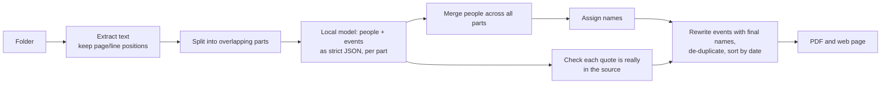

# casefile

Choose a folder of long, messy documents (emails, PDFs, Word files, notes, web pages) and get back
one list of what happened, in date order, with the important events marked so they stand out.

Everything runs on your computer, including the AI model. No document leaves it.

## Importance

Every event is marked with one of four levels, plus an icon for what kind of event it was.

| Mark | Level | Means |
|---|---|---|
| Red disc, red bold text, tinted row | **Major** | Changed the course of things: legal steps, formal notices, official findings, harm, large sums |
| Amber disc, bold text | **Notable** | A meaningful step: complaints, inspections, agreements, refusals, repairs, payments |
| Black icon, black text | **Standard** | An ordinary action or message |
| Grey icon, grey text | **Minor** | Routine background: acknowledgements, scheduling, chasing |

There is no green. Colour is never the only signal: major and notable events are also labelled
and set in bold, so the levels read in greyscale print and for colour-blind readers.

Icons (from [Lucide](https://lucide.dev), ISC licence): message, call, meeting, payment, legal,
inspection, incident, repair, decision, other.

## Get the app

Download the installer for your computer from the [Releases page](https://github.com/RossShelford/casefile/releases):

| Computer | File |
|---|---|
| Mac with Apple silicon (M1 and later) | `casefile-<version>-arm64.dmg` |
| Mac with Intel | `casefile-<version>.dmg` |
| Windows | `casefile Setup <version>.exe` |
| Linux | `casefile-<version>.AppImage` |

**First run.** casefile uses [Ollama](https://ollama.com), a free app, to run the AI model on your
computer. If it isn't installed, casefile shows a *Download Ollama* button; install it and choose
*Check again*. casefile then offers to download the AI model (about 4.7 GB, once), with a progress
bar. After that: choose *Choose folder*, pick a folder, and wait for the log. A running report can
be stopped with *Stop*. If Ollama is installed but not running, casefile starts it, and stops it
again when you quit. (If casefile crashes instead of quitting, that Ollama keeps running, as it
does when you open the Ollama app yourself; it frees the model's memory after 5 idle minutes.)

**Scanned PDFs** (photos of pages, with no text layer) are read with OCR if
[Tesseract](https://tesseract-ocr.github.io/tessdoc/Installation.html) is installed
(`brew install tesseract` on a Mac). Without it they're listed under *Sources* as needing OCR.
OCR takes about a second a page; the page shows which page it is on, and the text read out of
each PDF is saved with the report so a rerun doesn't read it again.

The folder is read where it is: nothing is copied or uploaded, and casefile never changes it.
Reports, the text read out of their PDFs, and the model's saved answers for their documents are
kept in casefile's own data folder until you choose *Delete* on that report, or *Delete all reports
and saved data* on the start page.

**The app isn't code-signed yet**, so the first launch needs one extra step:

- **Mac:** open the `.dmg` and drag casefile to Applications. Open it once; macOS refuses. Then go
  to *System Settings > Privacy & Security*, find "casefile was blocked", and choose *Open Anyway*.
- **Windows:** if SmartScreen says "Windows protected your PC", choose *More info*, then *Run anyway*.
- **Linux:** make the AppImage executable (`chmod +x casefile-*.AppImage`) and run it.

Each installer on the Releases page has a SHA-256 checksum (`SHA256SUMS.txt`) and a GitHub
build-provenance attestation, so you can check it was built from this repository:
`gh attestation verify <file> --repo RossShelford/casefile`.

Signing removes the extra step. It needs an Apple Developer ID (macOS) and a code-signing
certificate (Windows); electron-builder picks them up from the usual `CSC_LINK` /
`CSC_KEY_PASSWORD` / `APPLE_ID` environment variables once they exist.

**How the app is put together.** The window is Electron. The engine is the same Python code as the
command line, frozen with PyInstaller and shipped inside the app, so users don't need Python. At
each launch the app starts the engine with a new random secret, which only the app's own window
holds; the engine picks its own private port and tells the app which one. The engine refuses every
request without the secret, so no other program or website on the computer can use it, and it
exits by itself if the app closes or crashes. Electron's security fuses are set (no
`ELECTRON_RUN_AS_NODE`, no Node options or inspector flags, app files integrity-checked), and the
window only ever shows its own start page and the engine.

### Build the app

```sh
python -m venv .venv && .venv/bin/pip install -e .
cd desktop
npm ci
npm start          # run from source, using the Python in ../.venv
npm run dist       # build the engine (from the hashed lock file), then the installer, into desktop/release
```

Each operating system has to build its own installer. `.github/workflows/desktop.yml` does all
four on GitHub: push a tag such as `v0.2.0` and it runs the tests, builds every installer, attests
them, and attaches them with their checksums to a draft release.

## Install from source (command line and browser)

```sh
# 1. A local model server (Ollama shown; LM Studio / llama.cpp also work, see below)
brew install ollama            # or https://ollama.com/download
ollama serve &                 # skip if the Ollama app is already running
ollama pull qwen2.5:7b         # ~4.7 GB, works on a 16 GB laptop
brew install tesseract         # optional: reads scanned PDFs

# 2. casefile
pip install .
```

## Use it in the browser

```sh
casefile serve
# casefile: open http://127.0.0.1:8765/?token=...   <- open this exact link
```

Open the link `casefile serve` prints. It carries a secret that is new every time casefile starts;
the page stores it as a cookie and removes it from the address bar. Without it, casefile refuses
every request, so other people and programs on the same computer can't read your reports.

1. **Choose folder.** The page reads the folder and sends the readable files to casefile on this
   computer. Photos and other unreadable files are listed in the report but not sent.
2. Wait. The page shows how far it has got and roughly how long is left. You can close it; the
   report keeps building and appears under *Earlier reports*. *Stop* cancels it.
3. Read the log. Key (major) events are at the top. The importance chips filter the log, and
   choosing a person in *Who's who* shows only their events. *Show source*, in small grey under
   each date, opens the file, page or line, and the exact words an event came from.
   *Download PDF* gives the full report.

Built for very large folders: months are drawn only as you scroll to them, long lists (key events,
files, people, entries to check) come a page at a time with *Show more*, the file and people lists
have search boxes, and long folder paths are shortened with the full path on hover.

Uploaded copies are deleted as soon as a report finishes, fails or is stopped. Reports, the text
read out of their PDFs and the model's saved answers are kept in `~/.cache/casefile` until you
delete them: *Delete* on any report, *Delete all reports and saved data* on the start page, or
`casefile clear-cache`.

The service listens on this computer only (`127.0.0.1`). Besides the secret, it refuses requests
addressed to other host names (so a website can't reach it by DNS rebinding) and refuses to change
anything unless the request carries a header that other websites can't add.

### API

The page is a thin client over a small JSON API, which scripts can use too. Every request needs
the `casefile_token` cookie (set by opening the printed link, or send it yourself); calls that
change anything also need the header `X-Casefile: 1`.

| Call | Does |
|---|---|
| `GET /api/health` | Is the model server up and the model installed; `problem` is `server`, `model` or null |
| `POST /api/model/pull`, `GET /api/model/pull` | Download the model through Ollama; bytes done / total |
| `POST /api/jobs` `{"folder": "...", "title": "...", "not_sent": [...]}` | Create a job |
| `POST /api/jobs/{id}/files` multipart `files` + `paths` | Upload a batch of files with their relative paths |
| `POST /api/jobs/{id}/start` | Queue it. One job runs at a time |
| `GET /api/jobs/{id}` | Status (`uploading`, `queued`, `running`, `done`, `failed`, `cancelled`), parts done / total, estimated seconds left |
| `POST /api/jobs/{id}/cancel` | Stop it (a running job stops after the part in progress) |
| `GET /api/jobs/{id}/report` | The log as JSON: events with `importance`, `kind`, `icon`, people, sources |
| `GET /api/jobs/{id}/report.pdf` | The PDF |
| `DELETE /api/jobs/{id}` | Delete the job, its report, uploads and its cached model answers (never your documents) |
| `DELETE /api/data` | Delete every job and the whole cache |
| `POST /api/jobs/local` `{"path": "..."}` | Desktop app only: read a folder in place |

If casefile restarts, queued and interrupted jobs run again in the order they were created.
Finished parts are cached, so little work is repeated.

### Docker

```sh
docker build -t casefile .
docker run -p 127.0.0.1:8765:8765 -v casefile:/data casefile   # model: Ollama on the host
docker logs <container>                                         # shows the link to open
```

The image includes Tesseract, so scanned PDFs are read.

## Use it from the command line

```sh
casefile report ~/Documents/harbour-road                 # writes ~/Documents/harbour-road.pdf
casefile report ./case -o report.pdf --title "Smith v Jones"
casefile report ./case --api openai --url http://127.0.0.1:1234 --model qwen2.5-7b-instruct   # LM Studio
casefile clear-cache                                      # delete the model's saved answers
```

Runs can be stopped (Ctrl-C) and restarted: the text read out of each PDF and each part's answer
are cached in `~/.cache/casefile/parts`, so the rerun continues where it stopped. The answer is
keyed on the part's text alone, so renaming or moving a file, or the same letter turning up in two
folders, costs nothing; changing the model or prompt starts fresh. A part the model can't answer
(a model error, a timeout, malformed output, or an answer that never stops and is cut off at 3,000
tokens) is listed under *Parts the AI could not process* and the run carries on; only an
unreachable server or a missing model stops it. Failures that would repeat (malformed output
twice, a cut-off answer, a request the server refused) are remembered so a rerun doesn't pay for
them again; `casefile clear-cache` (or deleting the report in the app) forgets them.

| Option | Default | Meaning |
|---|---|---|
| `--model` | `qwen2.5:7b` | Model name on the server. Bigger models are slower but miss less. |
| `--api` | `ollama` | `openai` for any OpenAI-compatible server. |
| `--url` | `http://127.0.0.1:11434` | Model server address (`:1234` with `--api openai`). |
| `--context` | `8192` | Context window requested from Ollama. Must fit `--chunk-size` plus the answer. |
| `--chunk-size` / `--overlap` | `6000` / `600` | Characters per request for Latin text (Chinese, Japanese, Korean and Thai parts are made smaller to fit the same token budget), and how much neighbouring parts share. |
| `--jobs` | `1` | Parallel requests. Only helps if the server allows it: start Ollama with `OLLAMA_NUM_PARALLEL=2` and use `--jobs 2` (14-27% faster on a 16 GB M-series Mac). |
| `--no-quotes` | off | `report` only: leave the supporting quotes out of the main log (they always stay in *Needs checking*). |
| `--host` / `--port` | `127.0.0.1` / `8765` | `serve` only. `--port 0` picks a free port and prints `casefile: listening on 127.0.0.1:<port>`. |

### What it reads

| Kind | Files |
|---|---|
| Documents | `.pdf` (including PDFs locked against editing; scanned pages with Tesseract), `.docx`, `.odt`, `.rtf`, `.doc` (converted with macOS `textutil` or `antiword` when available; otherwise listed with a note to save it as `.docx`) |
| Email | `.eml`, Outlook `.msg`, mailboxes `.mbox`; attachments are read too and cited as `email.eml > attachment.pdf` |
| Spreadsheets and slides | `.xlsx`, `.pptx` |
| Text and web | `.txt .md .csv .tsv .json .log .xml .yaml .html .htm`, in UTF-8, UTF-16 or Windows encodings |

Hidden files are skipped. Text hidden from readers in web pages (`hidden`, `display:none` and similar)
is not sent to the model. A PDF that needs a real password is listed as password protected.

## The PDF

1. **Cover**: the period covered, the importance legend with counts, and the icon key.
2. **Key events**: every major event, first.
3. **Who's who**: everyone involved, listed once, by first name, with when they were active.
4. **At a glance**: each month, how much happened, how much was major, who was most involved. Click to jump.
5. **What happened**: the full log in date order, marked by importance. Every line cites its file and
   page or line, and quotes the exact words that support it. The PDF sidebar lists every year and month.
6. **Needs checking**: anything the AI reported but couldn't back up with a real quote from the source.
7. **Sources**: every file, how many events it gave, and any it couldn't read.

Text is set in [Atkinson Hyperlegible](https://www.brailleinstitute.org/freefont/) (SIL OFL), a
typeface designed for readability, in both the PDF and the page. Letters it lacks (Greek, Cyrillic,
Vietnamese) fall back to the bundled Noto Sans, and Chinese, Japanese, Korean, Thai, Arabic or
Hebrew to a suitable font already on the computer. If no font has a character, the PDF cover says so.

## How it works



The model only **extracts**. Everything that has to be consistent across thousands of files
(who is the same person, what to call them, ordering, removing duplicates, checking quotes)
is done by ordinary code, after all files are read. That's what keeps a 5,000-file run
coherent: a name chosen on page 1 is never changed on page 900.

### Naming

| Situation | Shown as |
|---|---|
| Only one Sarah | `Sarah` |
| Sarah Kim and Sarah Lee both appear | `Sarah Kim`, `Sarah Lee` (anyone else stays first-name only) |
| Two different people both called John Smith | `John Smith #1`, `John Smith #2` (by first appearance) |
| Known only by title and surname | `Dr. Patel` |
| A bare "Sarah" that could be either Sarah | `Sarah (unclear)` |

Joining name forms into one person:

- `Robert Smith`, `Smith, Robert`, `Mr. Robert Smith Jr.` are the same name.
- `Bob Smith` joins `Robert Smith` through a nickname list, but only if he's the only matching Smith.
- `Sarah`, `Dr. Kim` or `Sarah K.` join a full name only when exactly one person fits.
- A short form like "Sarah" counts only inside the part where the model linked it to a full name.
  That way "Sarah" in one email and "Sarah" in another can't merge two different Sarahs.
- The same full name in two files is treated as one person. Two genuinely different people with
  identical names cannot be told apart from text alone.

### Trust

- Every event must carry a word-for-word quote of at least 5 words and 25 characters. Code looks
  for it in the source text; case, whitespace, curly quotes and `...` gaps (each piece at least 3
  words) are allowed for. Events whose quote isn't found go to *Needs checking*, never into the
  main log.
- Documents can't give the model instructions: their text is fenced by a marker derived from the
  text itself, which a document can't reproduce, and the model is told to treat everything inside
  it as material to analyse. Two different full names are only merged into one person when they
  share a surname or a first name (or nickname), so a document can't make the model fuse two people.
- Importance is the model's judgement against a fixed rubric (see `casefile/taxonomy.py`). When
  copies of an event are merged, it keeps the highest level any copy was given, so a major event
  is never shown as minor because a duplicate was judged differently.
- Dates are kept only when unambiguous. `03/04/2023` (March or April?) is shown as written
  under *Undated* instead of being guessed.
- In a PDF, a long line that appears three times or more (a page header or footer, or the
  quoted copy of an earlier email that every reply in a printed chain carries) is read once, at
  its first appearance, so the model sees each passage with its date and context once. *Sources*
  says how many lines each file had read this way. Short lines (dates, amounts, names) are never
  touched, and nothing is removed across files.
- Duplicates (overlapping parts, reply chains that quote earlier emails) are removed only when
  the quoted evidence matches. "Sarah paid Tom" and "Sarah phoned Tom" on the same day stay two
  entries: a repeated line is better than a lost one.
- Files that couldn't be read (scanned PDFs without a text layer, unsupported types, errors)
  are listed under *Sources*. Nothing is dropped silently.

## Limits

- **Speed**: almost all the time goes on the model writing its answer (~15 tokens/s for
  `qwen2.5:7b` on a 16 GB Apple-silicon Mac). That averaged ~70 s per part (35-160 s; a part is up to
  6,000 characters, about 2-3 pages). 1,000 pages is roughly 400 parts, so expect most of a day.
  Run it overnight; it's cached and resumable. A desktop GPU is several times faster.
  Everything after the model is quick: 2,000 files / 28,000 events build and render in under 20 s.
- **Accuracy**: small models miss events and sometimes misread who did what. The quote check catches
  invented events, not wrong emphasis. A bigger model (`qwen2.5:14b`, `llama3.1:70b`) gives better
  results. Measured results are below.
- **Right-to-left and complex scripts** (Arabic, Hebrew, Thai, Indic) print in the PDF with the
  right letters but not joined or reordered; the web page shows them correctly.
- **Scanned PDFs** need Tesseract (see above); only English OCR data is installed by default
  (`brew install tesseract-lang` adds other languages).

### Measured accuracy

`evals/` holds three made-up but realistic cases (a damp tenancy, a workplace grievance, a kitchen
renovation dispute) with 53 hand-labelled events across email with attachments, Word, PDF, Excel,
RTF, HTML, CSV, a Slack export and a WhatsApp export. Results for `qwen2.5:7b` on a 16 GB M3 Mac
(casefile 0.2.0):

| Measure | Result |
|---|---|
| Labelled events found (recall) | 28 / 53 (53%) |
| Reported events that match a labelled one (precision) | 28 / 46 (61%) |
| Dates exactly right, for found events | 28 / 28 (100%) |
| Importance exactly right | 13 / 28 (46%) |
| Importance right or one level off | 26 / 28 (93%) |
| People found | 14 / 16 (88%) |
| People with the right name label | 14 / 16 (88%) |
| People split in two or wrongly merged | 0 |

Read it as: with a 7B model, expect roughly half of what happened to be listed, nearly all of it
correctly dated, and importance usually right or one step off. Precision is understated: several
"extra" events (e.g. a manager taking someone off overtime) are real events the labels didn't
include. A bigger model finds more. Rerun with `python -m evals.run --model <model>` to compare.

## Development

```sh
python -m venv .venv && .venv/bin/pip install -e '.[test,e2e]'
.venv/bin/playwright install chromium     # for the browser tests
.venv/bin/pytest                          # unit, service and browser tests
python -m evals.run --model qwen2.5:7b    # accuracy against labelled cases (needs Ollama; slow)
```

CI runs the tests on Linux, macOS and Windows for every push and pull request. See
[CONTRIBUTING.md](CONTRIBUTING.md) for the full workflow (prompt changes, the engine lock file,
releases) and [SECURITY.md](SECURITY.md) to report a vulnerability privately.

## License

casefile is open source under the [Apache License 2.0](LICENSE). You can use, change and share it,
including commercially, as long as you keep the licence and the [NOTICE](NOTICE) file.

It bundles [Lucide](https://lucide.dev) icons (ISC) and the
[Atkinson Hyperlegible](https://www.brailleinstitute.org/freefont/) and
[Noto Sans](https://notofonts.github.io/) typefaces (SIL Open Font License 1.1); their licences are
in `casefile/assets/icons/LICENSE`, `casefile/assets/fonts/OFL.txt` and
`casefile/assets/fonts/NotoSans-OFL.txt`.
